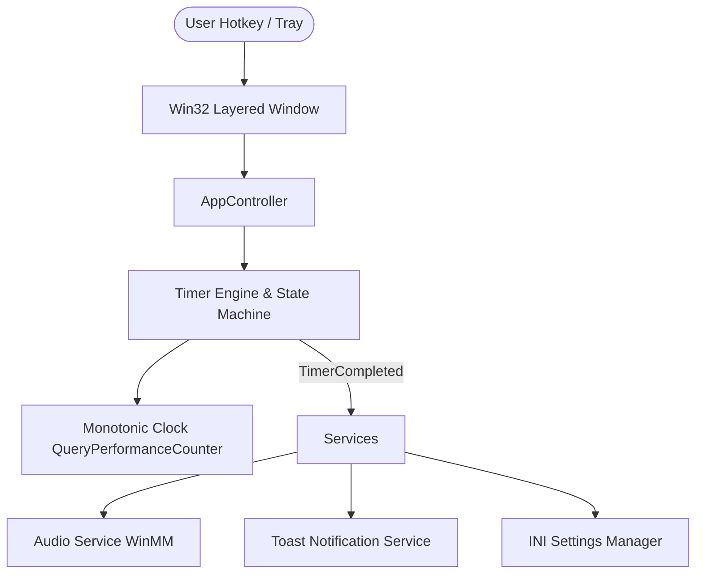

# Timer420 — Professional Windows Work Timer Overlay

[](https://github.com/Timer420/Timer420/actions)
[](LICENSE)
[](https://microsoft.com/windows)

**Timer420** is a high-performance, non-intrusive, transparent desktop work timer for Windows. Built in modern C11 with pure Win32 API, GDI double-buffering, and a monotonic high-resolution clock engine, Timer420 delivers microsecond timing accuracy without distracting you from your workflow.

---

## 🌟 Key Features

- ⏱️ **Monotonic High-Precision Clock**: Powered by `QueryPerformanceCounter`, avoiding wall-clock NTP time drift, DST jumps, or manual system time adjustments.
- 🎨 **3 Transparent Overlay Modes**:
  - **Minimal Mode**: Clean, elegant typography displaying remaining time and target deadline.
  - **Progress Mode**: Minimal layout + horizontal progress bar with percentage readout.
  - **Edge Border Mode**: Subtle 6px perimeter line tracing your screen boundary as time elapses.
- 🔄 **Auto-Repeating Timer**: Configurable multi-cycle or infinite `∞` work sessions.
- 🌙 **Windows Sleep / Resume Recovery**: Listens to system power state notifications (`WM_POWERBROADCAST`), auto-synchronizing elapsed time upon computer wake.
- 🔔 **Rich Alerts**: Windows Notification Toast balloons and audible completion chimes.
- 💾 **Settings Persistence**: Saves mode choices, custom durations, and preferences in `%APPDATA%\Timer420\timer420.ini`.
- ⌨️ **Safe Global Hotkeys**:
  - `Ctrl + Shift + Space`: Toggle overlay visibility
  - `Ctrl + Shift + S`: Start / Pause timer
  - `Ctrl + Shift + R`: Reset timer
- 🧪 **100% Testable Engine**: Includes `FakeClock` mock suite capable of running 2-hour duration tests in under 1 millisecond.

---

## 📐 Architecture Overview



Detailed technical documentation is available in [`docs/ARCHITECTURE.md`](docs/ARCHITECTURE.md).

---

## 🚀 Quick Start

### Installation

1. Download the latest release `.zip` from the [Releases](https://github.com/Timer420/Timer420/releases) page.
2. Extract `Timer420.exe` to your preferred directory.
3. Run `Timer420.exe`. The timer icon will appear in your Windows System Tray.

---

## 🛠️ Building from Source

### Prerequisites
- **Compiler**: MSVC (Visual Studio 2019/2022) or MinGW-w64 (GCC 11+) / Clang
- **Build System**: [CMake](https://cmake.org/) v3.20+
- **Platform**: Windows 7 / 10 / 11

### Build Steps

```cmd
# Clone repository
git clone https://github.com/Timer420/Timer420.git
cd Timer420

# Generate build files
cmake -B build -S .

# Compile release executable
cmake --build build --config Release
```

The compiled binary will be placed at `build/Release/Timer420.exe`.

---

## 🧪 Running Automated Tests

Timer420 features a complete unit test suite validating state machine transitions, clock precision, pause stability, and multi-hour instant advancements:

```cmd
# Run test suite via CTest
ctest --test-dir build --output-on-failure
```

Or run the test binary directly:
```cmd
.\build\Release\timer420_tests.exe
```

---

## 📄 Documentation

- [Architecture Analysis](docs/ARCHITECTURE_ANALYSIS.md)
- [Timer Behavior Specification](docs/TIMER_BEHAVIOR.md)
- [Migration & Refactoring Plan](docs/MIGRATION_PLAN.md)
- [Building & Toolchains](docs/BUILDING.md)
- [User Guide](docs/USER_GUIDE.md)
- [Configuration Reference](docs/CONFIGURATION.md)
- [Testing Strategy](docs/TESTING.md)
- [Release Process](docs/RELEASE_PROCESS.md)

---

## 🤝 Contributing

Contributions are welcome! Please read [`CONTRIBUTING.md`](CONTRIBUTING.md) for details on code style, commit conventions, and pull request procedures.

---

## 📜 License

Timer420 is licensed under the [MIT License](LICENSE).
