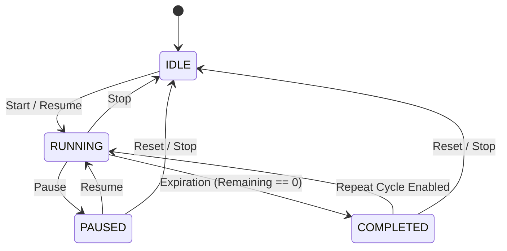

# Timer Behavior Specification - LastMoment / Timer420

## 1. Current Prototype Behavior Analysis

In the initial prototype (`LastMoment.c`), timer behavior is managed through wall-clock epoch timestamps:
- **Time Source**: `time(NULL)` (standard C library wall-clock time, 1-second resolution).
- **Target Deadline**: `g.deadlineEpoch = time(NULL) + g.remainingSeconds`.
- **Tick Interval**: `WM_TIMER` fires every 250ms to refresh the display, calculating `remaining = deadlineEpoch - time(NULL)`.
- **Pause Behavior**: Freezes remaining time by computing `remainingSeconds = deadlineEpoch - time(NULL)`.
- **Resume Behavior**: Recomputes `deadlineEpoch = time(NULL) + remainingSeconds`.
- **Completion**: When remaining time reaches 0, `g.running` is set to `FALSE`, display color turns red, and text shows "TIME'S UP".

---

## 2. Identified Deficiencies in Current Behavior

1. **Wall-Clock Vulnerability**: `time(NULL)` is affected by manual clock adjustments, NTP time synchronizations, and Daylight Saving Time transitions.
2. **Pause/Resume Truncation Drift**: `time(NULL)` operates with 1-second granularity. Pausing and resuming repeatedly causes cumulative time loss due to integer division truncation.
3. **Global Escape Hotkey Bug**: `RegisterHotKey(hwnd, HOTKEY_ESC, 0, VK_ESCAPE)` traps the Escape key globally across all open desktop windows.
4. **No Cycle Repetition**: The prototype cannot automatically restart a new cycle or track completed cycles.
5. **No System Sleep/Resume Handling**: If the computer enters sleep mode for 30 minutes during a 2-hour timer, `time(NULL)` jumps upon wake-up, but no event is raised for missed timer expiration while sleeping.
6. **No Sub-Second High Resolution**: Display update occurs 4 times per second, but calculations are locked to whole seconds.

---

## 3. Target Architecture Timer Specification

### 3.1 Time Source & High-Resolution Precision
The new Timer Core uses a **Monotonic Clock** (`QueryPerformanceCounter` on Windows, wrapped behind a generic `Clock` abstraction).
- Monotonic time guarantees strictly increasing ticks unaffected by system wall-clock updates.
- Internal precision is tracked in milliseconds (or nanoseconds), avoiding rounding drift.

### 3.2 Timer State Machine

- **IDLE**: Initial or reset state. Duration configured, remaining time equals total duration.
- **RUNNING**: Countdown active. Ticks evaluate elapsed monotonic time.
- **PAUSED**: Countdown suspended. Monotonic target offset is frozen.
- **COMPLETED**: Time reached 0. `TimerCompleted` event emitted. If auto-repeat is active, transitions to `RUNNING` for next cycle.

### 3.3 Repeating Timer Mechanism
- Supports single-shot or multi-cycle repeating mode (finite count or infinite `∞`).
- Tracks:
  - `configured_duration_ms`
  - `elapsed_duration_ms`
  - `remaining_duration_ms`
  - `current_cycle`
  - `completed_cycles`
  - `max_cycles` (0 = infinite)

### 3.4 System Sleep / Resume Behavior
- The platform layer listens to `WM_POWERBROADCAST` (`PBT_APMRESUMESUSPEND` / `PBT_APMRESUMEAUTOMATIC`).
- Upon system resume:
  1. The Monotonic Clock evaluates actual real-world time elapsed during sleep.
  2. If target duration expired while computer was sleeping, the timer immediately triggers `COMPLETED` event and dispatches catch-up notification upon resume.
  3. If duration has not expired, remaining time is adjusted accurately without drift.
